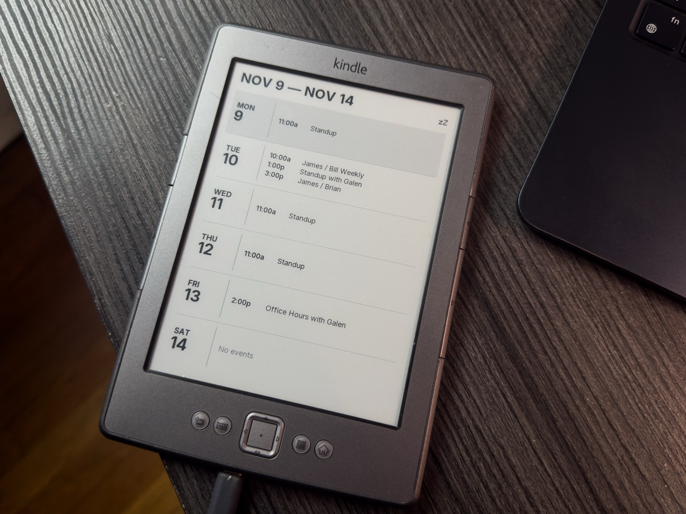

# Kindle Calendar

Turn a Kindle 4 into a dedicated e-ink calendar. The display shows today and
the next five days from one or more Google Calendars. Busy days get more room,
all-day events appear first, and today's row is highlighted.



The Kindle side was tested on a Kindle 4 Non-Touch (D01100, firmware 4.1.4).

## How it works

1. A Python service reads private Google Calendar iCal feeds, expands recurring
   events, and uses Pillow and Inter to render a 600×800 grayscale PNG.
2. The Kindle polls `/calendar.png` over Wi-Fi about every 15 minutes while
   awake. A matching ETag lets it skip downloading an unchanged image.
3. The Kindle draws the downloaded image with its built-in e-ink utility and
   adds an `On` or `zZ` power indicator locally. The screen retains the last
   image and indicator during sleep.

The server runs in Docker or as a desktop systemd service. The Docker
deployment accepts one iCal feed URL per line in `CALENDAR_URLS`. The endpoint
serves calendar details over local-network HTTP, with access controlled by the
deployment network or the server's IP allowlist.

## Preview with sample events

From the repository root:

```sh
python3 -m venv .venv
.venv/bin/python -m pip install -r appliance/requirements.txt
.venv/bin/python appliance/render_six_day.py --output /tmp/kindle-calendar-preview.png
```

## Setup and maintenance

| Start here | What it covers |
| --- | --- |
| [Calendar server](docs/CALENDAR.md) | Feed configuration, Docker deployment on TrueNAS, and the desktop service |
| [Kindle USB and firmware](firmware/AGENTS.md) | Reviewed packages, backups, USB networking, and recovery |
| [Kindle appliance operation](docs/OPERATING.md) | Startup, Wi-Fi polling, and returning to the stock reader |
| [Technical log](docs/TECHNICAL-LOG.md) | Hardware tests, design decisions, and known limitations |

The [appliance directory](appliance/) contains the renderer, server, Docker
configuration, and scripts that run on the Kindle.
